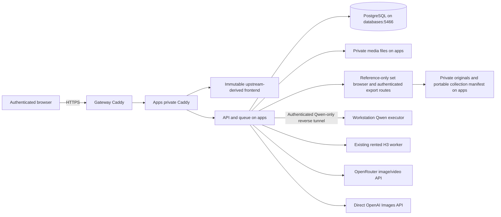

# Nora data flow

Verified reference-library addition against `7818f67` and live production, 2026-11-02;
base generation topology remains `nora-v2-9215134`. See `deploy/pending-prod.md`.

Credentials remain server-side. Static access authenticates before file serving;
API and media use the same protected session. H3 retains an independent apps user
systemd pause timer. Workstation disconnection affects Qwen only. No generation
runs on import, page loading, catalog discovery or availability polling.
