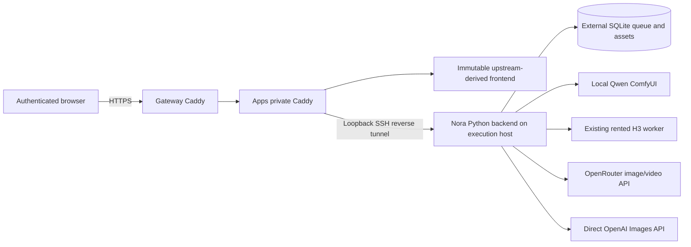

# Nora data flow

Verified against source `8b61e89`, 2026-11-01. Live deployment checks are recorded
in `deploy/pending-prod.md`.

Static routes use the backend authentication check. API/media routes require the
same session. The frontend receives capability and credential-presence flags;
provider keys, worker SSH credentials and reference files stay off apps storage.
H3 generation retains its independent pause timer. No generation runs on import,
page loading or catalog discovery.
