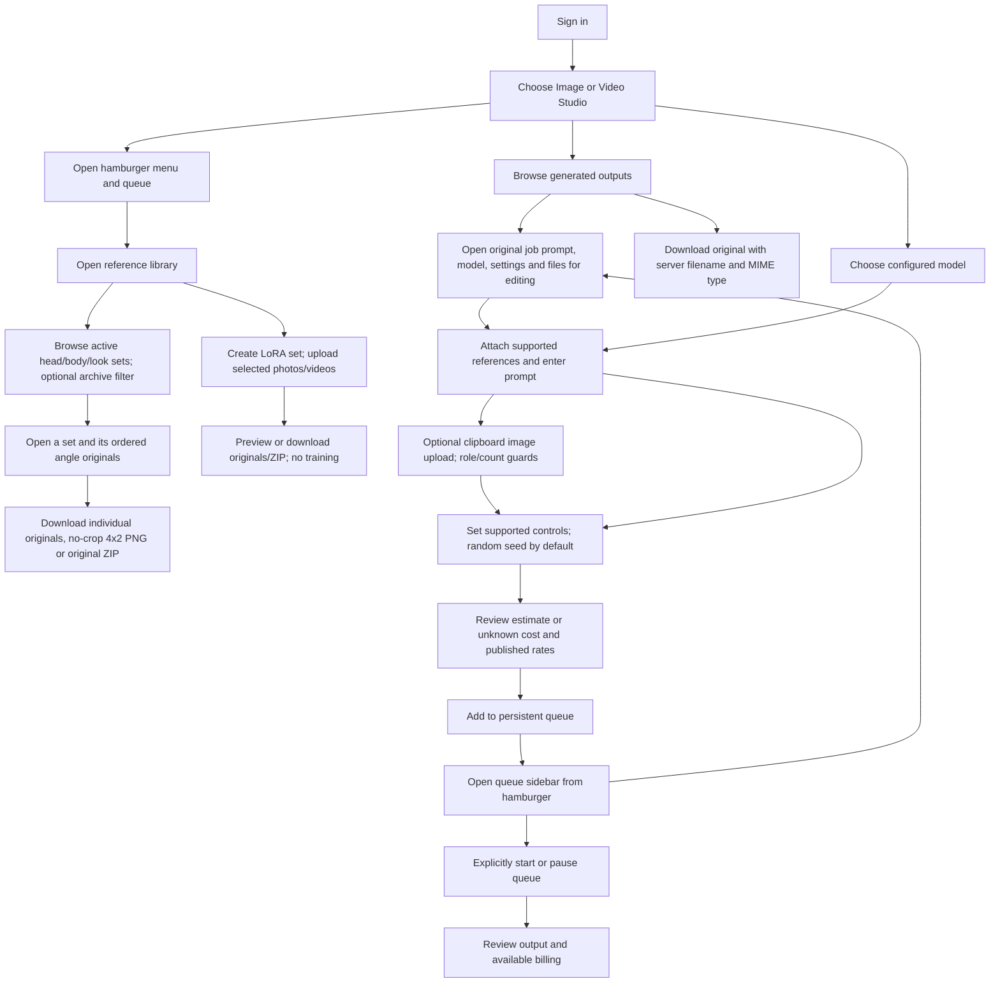

# Nora generation journey

Verified against studio usability implementation `6dfc50a` and live production, 2026-11-02.
See the deployment ledger for source revisions and live browser verification.

Input references stay unmodified by the adapter. H3 guide conditioning can crop
inside the model when guide/output aspect ratios differ; the form explains this.
Other MuAPI studios are explicitly unconnected. Queued or running work blocks
catalog refresh so its endpoint settings are not replaced underneath it. Empty
prompts do not trigger cost-estimate requests.

Seed-capable models offer random or fixed seeds. Enqueue selects and saves the
actual random seed; the sidebar displays it for supported models, and retry keeps
the saved seed. Opening/closing the sidebar does not change queue execution.

The parameter modal edits a separate draft. Apply commits the supported settings
together; Cancel/Escape/backdrop discard edits. Its field region scrolls within
the viewport while Apply/Cancel remain reachable on mobile.

User library uploads can be replaced in place or removed after confirmation.
Removal clears active set/export membership while retaining a private archive;
legacy read-only references remain protected. Studio attachments can likewise be
replaced in place before enqueueing. These actions never trigger inference.

Archiving an entire set is presentation metadata: its originals remain downloadable
when the archive filter is enabled. This differs from removing an individual upload,
which excludes that record from public download/export access. Set exports use only
that set's ordered members; the collapsed custom builder supports mixed selections.

Qwen-only executor readiness updates with state polling. Offline Qwen disables
submission/retry while cloud/H3 remain usable; queued offline Qwen work waits for
its executor without blocking eligible cloud jobs.
