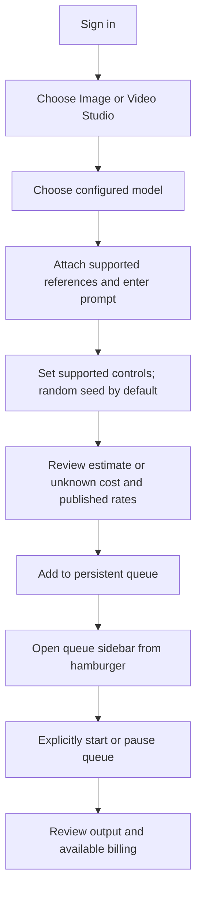

# Nora generation journey

Updated for the seed controls and queue sidebar, 2026-11-01.
See the deployment ledger for source revisions and live browser verification.

Input references stay unmodified by the adapter. H3 guide conditioning can crop
inside the model when guide/output aspect ratios differ; the form explains this.
Other MuAPI studios are explicitly unconnected. Queued or running work blocks
catalog refresh so its endpoint settings are not replaced underneath it. Empty
prompts do not trigger cost-estimate requests.

Seed-capable models offer random or fixed seeds. Enqueue selects and saves the
actual random seed; the sidebar displays it for supported models, and retry keeps
the saved seed. Opening/closing the sidebar does not change queue execution.

Qwen-only executor readiness updates with state polling. Offline Qwen disables
submission/retry while cloud/H3 remain usable; queued offline Qwen work waits for
its executor without blocking eligible cloud jobs.
