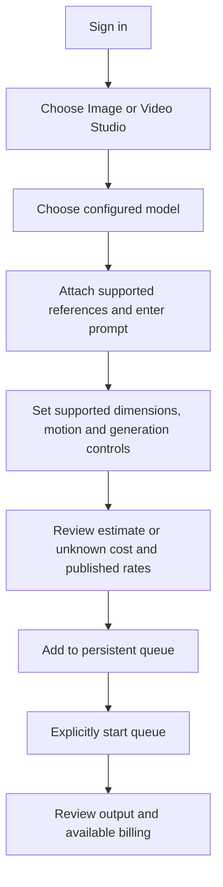

# Nora generation journey

Verified against the original studio forms plus Nora adapters at `8b61e89`,
2026-11-01. See the deployment ledger for live browser verification.

Input references stay unmodified by the adapter. H3 guide conditioning can crop
inside the model when guide/output aspect ratios differ; the form explains this.
Other MuAPI studios are explicitly unconnected. Queued or running work blocks
catalog refresh so its endpoint settings are not replaced underneath it. Empty
prompts do not trigger cost-estimate requests.
