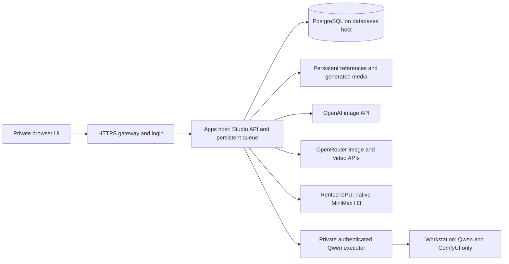

# Generation Studio architecture

## Migration target — deployment pending verification

This diagram describes the requested migration. It is not proof that these services
have been deployed; the deployment README and release ledger own that status.

The apps host owns the browser frontend, authentication, catalog, queue controller,
cloud-provider calls and rented H3 GPU control. PostgreSQL on the databases host
owns persistent job state. References and media remain in persistent server storage;
the database stores their metadata. The workstation runs only the Qwen executor and
its local ComfyUI runtime. A browser does not receive provider keys or executor
credentials.

Turning off the workstation affects Qwen availability. Cloud photo/video models and
H3 remain independently usable from the apps host. The UI displays Qwen's reported
readiness and reason, disables submitting or retrying unavailable models, and keeps
queue controls available for other models. The API and queue dispatcher remain the
authority for readiness checks, including jobs queued before an executor disconnects.
The browser check is not an execution guarantee.

## Readiness contract

`/api/state.capabilities.models` contains per-model `available`, `availability` and
`availability_reason`. Qwen reports `executor_ready` or `executor_offline`. Additional
Qwen executor diagnostics are under `capabilities.executors.qwen` (or a root-level
`executors.qwen` when supplied by an adapter): `configured`, `available`, `status` and
`reason`. The UI updates from the regular state poll without changing selected
references, prompts or model parameters.

H3's configured status does not assert live GPU health or resume a paid worker.
The browser does not contact the workstation directly. Provider pricing and
billing still come from the server; the diagram does not imply a fixed GPU cost.
